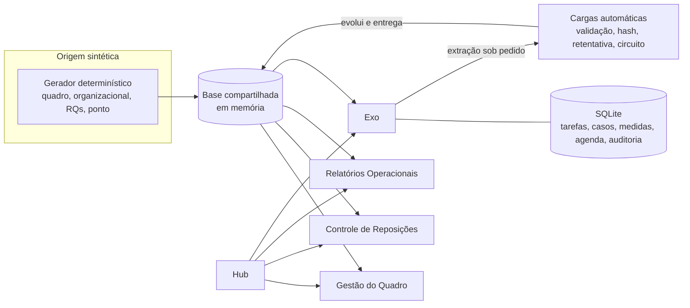

# Ecossistema de Governança de Pessoas

Réplica de demonstração de um conjunto de aplicações internas de **gestão de pessoas em operações de atendimento**: um hub de acesso, um assistente de gestão e três painéis analíticos alimentados por cargas automáticas.

> Todos os dados são **100% sintéticos**, gerados por código com semente fixa. Não há nomes reais, empresas, fornecedores, endereços ou credenciais. A hierarquia usa rótulos genéricos (`Gerente 1`, `Coordenador 3`, `Supervisor 12`, `Agente 0042`).

## Módulos

| Módulo | O que faz |
|---|---|
| **Hub de Governança** | Catálogo dos sistemas com status ao vivo, links internos e externos editáveis (CRUD persistido em JSON) e resumo das cargas automáticas. |
| **Exo** | Assistente de gestão com login e escopo por nível hierárquico: painel do dia, tarefas com histórico, casos individuais, medidas disciplinares com sugestão de progressão, agenda com decisões que viram tarefas, visão de equipes, busca global, monitoramento das cargas e trilha de auditoria. |
| **Gestão do Quadro** | Auditoria de hierarquia (dentro do próprio quadro e contra o sistema organizacional) com rastreio da origem de cada divergência, diagnóstico das suposições, novatos por turma, vagas, histórico do quadro dia a dia, desligados e contas pendentes de baixa. |
| **Controle de Reposições** | Prazo de abertura de RQ em dias úteis após o desligamento, controle das requisições, quadro de vagas por supervisão e evolução diária. |
| **Relatórios Operacionais** | Interjornada (descanso < 11h), excedentes e sub-jornada a partir de login e logout, com filtros hierárquicos, reincidência e detalhe por colaborador. |
| **Cargas automáticas** | Ciclo em segundo plano que "extrai" os arquivos de origem, valida o layout, compara por hash, entrega só o que mudou, guarda pendências para a próxima rodada, abre circuito após falhas seguidas e atende extrações sob pedido. |

## Arquitetura



- **Backend:** FastAPI em um único processo. Cada módulo é um `APIRouter` (`app/modulos/`). As regras de negócio ficam em funções puras e testáveis (`app/dominio/`), separadas das rotas.
- **Frontend:** HTML, CSS e JavaScript (ES modules) **sem etapa de build**. Um design system próprio (`frontend/design-system/`) fornece tokens com tema claro e escuro, componentes (tabela com busca, ordenação, paginação e exportação CSV, filtros hierárquicos em cascata, KPIs, modais, avisos) e o wrapper de gráficos (Chart.js).
- **Exo:** senhas com PBKDF2-SHA256 e sal, sessão em cookie `HttpOnly`, bloqueio após tentativas seguidas, escopo de dados aplicado no SQL (o navegador esconde telas, mas quem protege o dado é o backend) e auditoria de toda alteração.

## Dados sintéticos

`app/dados/sinteticos.py` gera, a partir de uma semente:

- **Hierarquia:** 1 diretoria, 4 gerências, 12 coordenações, 48 supervisões e cerca de 530 agentes, distribuídos em 8 serviços e 3 sedes.
- **Quadro funcional** com cargo, turno, admissões, desligamentos dos últimos 120 dias (voluntários, involuntários, promoções e outras saídas), férias, afastamentos e trocas de supervisão.
- **Inconsistências propositais** para a auditoria encontrar: coordenação trocada, gerência vazia e supervisão divergente entre o quadro e o sistema organizacional.
- **Jornada das reposições:** cada desligamento passa por Abertura RQ, Aprovação RH, Recrutamento e Remuneração até a admissão, com prazo de abertura de 7 dias (carência de 3), RQs congeladas e aumentos de quadro.
- **Login e logout** de 30 dias, com jornadas de 4h, 6h e 8h12, faltas, saídas antecipadas, horas extras e dobras que geram interjornada.

A cada rodada, as cargas automáticas fazem a base "andar": surgem desligamentos, RQs são abertas e avançam de status. As telas refletem isso sem recarregar o servidor.

## Como rodar

Requer Python 3.10 ou superior.

```bash
# Windows
iniciar.bat

# Linux / macOS
./iniciar.sh
```

Ou manualmente:

```bash
python -m venv .venv
.venv/bin/pip install -r requirements.txt   # no Windows: .venv\Scripts\pip
python -m app.main
```

Abra <http://127.0.0.1:8000>. A documentação interativa da API fica em `/docs`.

**Usuários do Exo** (senha `demo123`):

| Login | Papel | Enxerga |
|---|---|---|
| `admin` | Administrador | Tudo, incluindo monitoramento e auditoria |
| `gerente1` | Gestor | Gerente 1 e abaixo |
| `coordenador1` | Gestor | Coordenador 1 e abaixo |
| `supervisor1` | Gestor | Equipe do Supervisor 1 |

### Configuração

Por variáveis de ambiente, todas opcionais:

| Variável | Padrão | Uso |
|---|---|---|
| `ECOSSISTEMA_PORTA` | `8000` | Porta HTTP |
| `ECOSSISTEMA_HOST` | `127.0.0.1` | Interface de escuta |
| `ECOSSISTEMA_SEMENTE` | `42` | Semente dos dados sintéticos |
| `ECOSSISTEMA_INTERVALO_CARGAS` | `60` | Segundos entre rodadas das cargas automáticas |
| `ECOSSISTEMA_CARGAS_ATIVAS` | `1` | `0` desliga o ciclo em segundo plano |
| `ECOSSISTEMA_VAR` | `./var` | Pasta do SQLite e dos links do Hub |

Para recomeçar do zero, apague a pasta `var/`.

## Testes

```bash
pip install -r requirements-dev.txt
pytest
```

Cobrem o gerador (determinismo, unicidade, coerência de datas), as regras de domínio (auditoria, dias úteis, SLA de abertura, jornada e interjornada, fechamento do quadro de vagas) e a API (filtros, autenticação, escopo e fluxo de tarefa). O GitHub Actions roda a suíte em Python 3.10 e 3.12.

## Estrutura

```
app/
  config.py            configuração por variáveis de ambiente
  main.py              aplicação FastAPI e ciclo de vida
  dados/               gerador sintético, base compartilhada e filtros
  dominio/             regras de negócio puras
  modulos/             rotas de cada aplicação (hub, exo, quadro, reposições, relatórios, cargas)
frontend/
  design-system/       tokens, componentes CSS e utilitários JS compartilhados
  hub/ exo/ quadro/ reposicoes/ relatorios/
tests/
```
